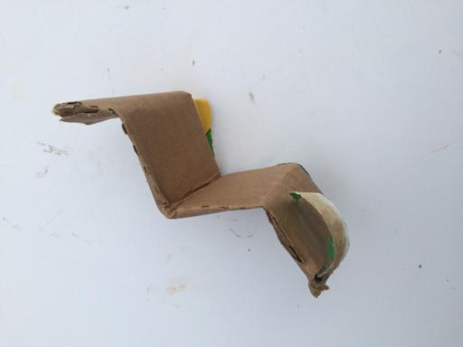
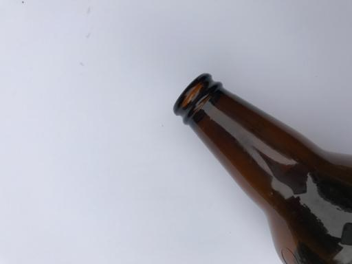
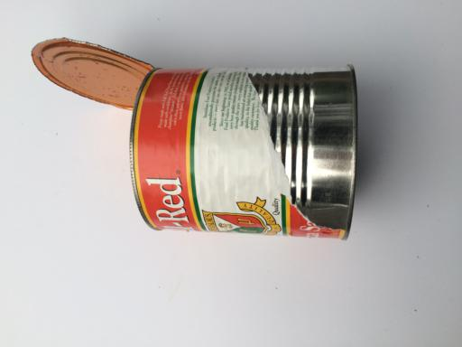
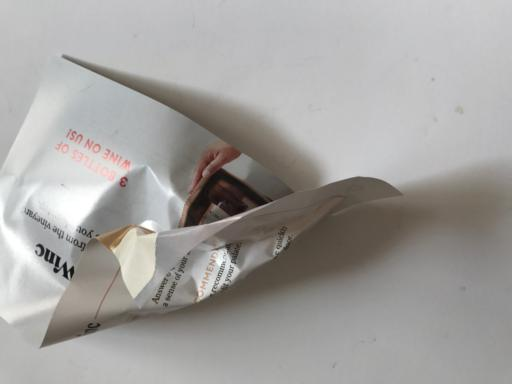
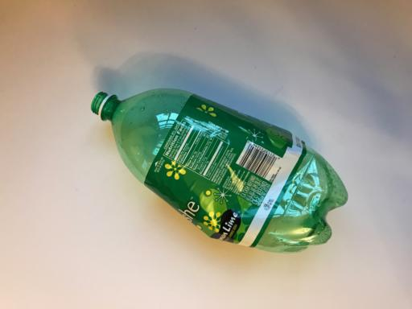
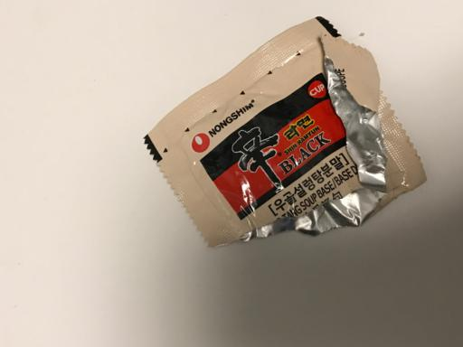

# TrashNet Clean V1 Dataset

This repository includes the **Clean V1** split of the six-class TrashNet waste image dataset. It contains 2,521 JPEG images in `data/train`, `data/val` (validation), and `data/test`. The split directories match the existing `src/train_transfer.py` paths.

## Source, labels, and license

The images originate from Gary Thung and Mindy Yang's TrashNet project: [github.com/garythung/trashnet](https://github.com/garythung/trashnet). The upstream README describes the six source categories and states that the project collected the dataset. The upstream class-folder names are the labels used here. Clean V1 preserves those source folder labels for retained images; no new manual relabeling was performed.

The upstream repository provides an MIT License, and the author's TrashNet dataset page is marked MIT. The upstream copyright and MIT permission notice are retained at [`data/THIRD_PARTY_LICENSES/TRASHNET_MIT_LICENSE.txt`](data/THIRD_PARTY_LICENSES/TRASHNET_MIT_LICENSE.txt). Please cite the original TrashNet project when using the data.

## Classes and examples

The class names below are the dataset's categories, not a jurisdiction-specific recycling guide. Examples link to actual retained images in this repository.

| Class | Typical items visible in this dataset | Example image |
|---|---|---|
| `cardboard` | Corrugated cardboard and packaging boxes |  `cardboard173.jpg` |
| `glass` | Glass bottles and jars |  `glass120.jpg` |
| `metal` | Metal cans and metal packaging |  `metal188.jpg` |
| `paper` | Paper packaging, printed paper, and paperboard items |  `paper238.jpg` |
| `plastic` | Plastic bottles, tubs, and packaging |  `plastic269.jpg` |
| `trash` | The source dataset's residual trash category; examples include non-recyclable or mixed discarded items |  `trash77.jpg` |

The examples illustrate the existing class folders; they do not constitute independent verification of each item's material or recyclability.

## Dataset structure and counts

```text
data/
├── train/
│   ├── cardboard/  glass/  metal/  paper/  plastic/  trash/
├── val/  # Validation
│   ├── cardboard/  glass/  metal/  paper/  plastic/  trash/
├── test/
│   ├── cardboard/  glass/  metal/  paper/  plastic/  trash/
├── manifests/
│   ├── split_manifest.csv
│   ├── sha256_manifest.csv
│   ├── class_counts.csv
│   └── excluded_files.csv
└── THIRD_PARTY_LICENSES/
    └── TRASHNET_MIT_LICENSE.txt
```

| Class | Train | Validation | Test | Total |
|---|---:|---:|---:|---:|
| cardboard | 282 | 60 | 61 | 403 |
| glass | 348 | 75 | 75 | 498 |
| metal | 286 | 61 | 62 | 409 |
| paper | 416 | 89 | 89 | 594 |
| plastic | 336 | 72 | 72 | 480 |
| trash | 96 | 21 | 20 | 137 |
| **Total** | **1764** | **378** | **379** | **2521** |

## Clean V1 construction and split

The source TrashNet resized collection contains 2,527 images. Clean V1 retains 2,521 and excludes six files forming three exact byte-duplicate pairs whose folder labels conflict. The correct labels were not adjudicated. The exact files, SHA256 values, and reasons are recorded in [`data/manifests/excluded_files.csv`](data/manifests/excluded_files.csv).

The retained images were split with stratified sampling at 70% / 15% / 15%, `random_state=42`. The fixed membership is recorded in [`data/manifests/split_manifest.csv`](data/manifests/split_manifest.csv); do not regenerate the split for comparisons. The per-image SHA256 list is in [`data/manifests/sha256_manifest.csv`](data/manifests/sha256_manifest.csv), and class counts are in [`data/manifests/class_counts.csv`](data/manifests/class_counts.csv).

The Clean V1 audit found all retained images readable, no exact SHA256 duplicates among retained images, and no duplicate content across Train, Validation, or Test. The six excluded images are the known conflicting-label duplicate pairs.

## Train the Frozen ResNet18 baseline

From the repository root, with the project dependencies installed and ImageNet weights available to torchvision, run:

```bash
python src/train_transfer.py
```

The existing entry point reads `data/train` and `data/val`, uses the Frozen ImageNet-pretrained ResNet18 configuration, and saves its best validation checkpoint under `models/`. Test images are not used by this training entry point; reserve `data/test` for one final evaluation after model selection. Keep the supplied split manifest fixed when comparing experiments.

## Citation

Please cite the original TrashNet project by Gary Thung and Mindy Yang: [github.com/garythung/trashnet](https://github.com/garythung/trashnet).
