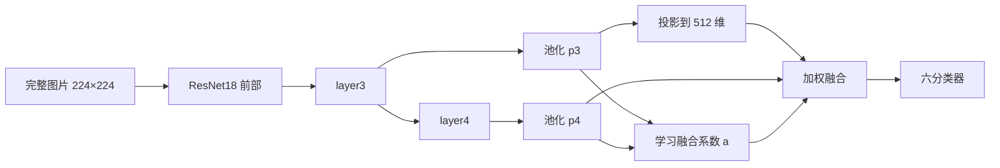

# 双层特征融合：方案与验证记录

2026-11-10。本轮从训练设置调优进入结构试验。原假设是检验补充中间层特征、按样本调整融合比例，是否能提高光照与模糊干扰下的分类表现，同时保留干净分类及塑料识别能力。下文保留原设计和判定规则，后续结果单独记录；当前证据支持固定融合，自适应门控没有通过原条件。

## 依据与研究边界

前轮更深微调提高了干净 Macro-F1，但塑料召回、暗光和强模糊表现下降。仅更改训练范围未解决已知矿泉水瓶实拍失败案例。因此本轮考虑改变模型如何使用不同层次的特征。

| 相关研究 | 已有思想 | 本轮如何处理 |
|---|---|---|
| [FPN，CVPR 2017](https://arxiv.org/abs/1612.03144) | 利用网络的多层、多尺度特征，原工作主要针对检测 | 仅借鉴跨层信息互补思路；本轮没有 FPN 的完整自顶向下结构，也不做检测 |
| [SKNet，CVPR 2019](https://arxiv.org/abs/1903.06586) | 根据输入动态加权多分支、不同感受野的信息 | 借鉴自适应融合思想；本轮是 ResNet18 layer3/layer4 的全局向量融合，不是原 SK 卷积模块 |
| [AugMix，ICLR 2020](https://arxiv.org/abs/1912.02781) | 用数据处理提高腐蚀鲁棒性 | 说明增强本身已有研究。本轮使用现有光照/模糊增强作为匹配强对照，没有声称复现 AugMix |
| [Supervised Contrastive Learning，NeurIPS 2020](https://arxiv.org/abs/2004.11362) | 用标签组织类内/类间表征，原论文报告腐蚀鲁棒性收益 | 作为学习目标路线的备选，本轮先保持交叉熵，隔离结构改动 |
| [改进 EfficientNetV2 垃圾分类，2025](https://arxiv.org/abs/2503.21208) | 垃圾分类中也已有注意力、多尺度模块与增强的结合 | 进一步限定新颖性：多尺度或注意力用于垃圾分类并非本组首次提出；不把不同数据与协议的论文成绩当作本地基准 |

另检索到 2026 年同类跨尺度、门控垃圾识别研究，例如 [BCDS-Net](https://www.nature.com/articles/s41598-026-74844-2)。其出版方检索摘要可见，本次没有完整获取正文，因此只作为相关性线索，不引用其分数或实现细节。

本组可主张的是：针对本地观察到的问题设计、实现一个具体变体，做匹配对照、固定融合消融和干扰/逐类分析。本轮不能主张首创多尺度、首创注意力或全面领先已有垃圾分类研究。应用/变体项目的技术贡献要由实验证据和分析支撑。

## 具体网络

保留 ImageNet 预训练 ResNet18 主干。224×224 输入下，layer3 为 256×14×14，layer4 为 512×7×7；分别全局平均池化得到 p3、p4。

- d = ReLU(Linear256→512(p3))：对齐中间层描述。
- a = sigmoid(Linear32→1(ReLU(Linear768→32([p3,p4]))))：逐样本标量混合系数。
- z = a·d + (1−a)·p4，最后使用相同的 Linear512→6 分类器。
- 固定融合消融将 a 固定为 0.5。

门控最后一层以零初始化，使自适应版本与固定融合在初始时严格一致；主干与六分类器在同一种子下也与对照初始化相同。投影和门控位于 fc 模块内，按原有分类头/主干两阶段流程训练。

较高分辨率的中间特征可能提供补充信息，是本轮推断；它没有保证包含真正材质信息。模型仍为单标签六分类，完整图片输入不变，门控不是区域检测或材质分割。

## 单种子试验与停止规则

仅训练 seed42 三组：匹配增强强对照、固定融合、自适应融合。三组统一使用冻结基线设置中的微调范围、相同 3+7 轮、输入、优化器、光照/模糊增强和逆频率类别加权。旧 layer4 增强成绩保留为背景，不能替代本轮匹配训练范围的强对照。

每组继续按干净验证 Macro-F1 选 checkpoint。主要比较指标预先设为：亮度五条件平均 F1 与模糊三条件平均 F1 的均值；两类干扰各占一半。逐项条件沿用既有验证预览。

只有自适应版相对强对照的干扰得分至少增加 0.01、干净 F1 下降不超过 0.01、塑料召回下降不超过 0.02，而且比固定融合至少高 0.005，才建议进入多种子确认。若不满足，保留原型和负面结果，本轮不追加调参。即使通过，单种子也不能证明稳定改进。

本轮不使用保留测试集和已知水瓶选择模型，不自动替换演示默认。门控系数只是混合比例，不能解释成正确概率或材质比例。多尺度版热图改在 layer3 计算，覆盖两条分支的反向路径；它仍是定性解释。

## 首轮试验后的更新

三组 seed42 试验已完成，详见 `MULTISCALE_PILOT_RESULTS.md`。固定融合表现优于匹配强对照，但门控未超过固定融合，不满足原预定继续条件；原门控假设没有被证实。门控贡献检查进一步发现该 checkpoint 几乎不使用中间层分支。

后续候选改为较简单的固定融合，需要单独预注册多种子复核，不能把本轮改写成门控成功。确认稳定收益后，还应考虑参数量接近的分类头对照，以区分跨层信息和增加参数的作用。继续门控路线则需对分支被抑制的训练过程另立假设，本轮不追加搜索。

## 多种子与容量对照后的更新

固定融合与匹配强对照的 seed42/43/44 已复核，平均均衡干扰 F1 为 0.8367 / 0.8108，三个配对种子均提高。详见 `FIXED_FUSION_CONFIRMATION_REVIEW.md`。

随后按预先固定的计划新增同层残差容量头 `512→128→512`，只直接使用 layer4 描述，不引入额外 Dropout；它与固定融合只差 128 个参数。容量头三种子平均均衡干扰 F1 为 0.8049，固定融合相对其三个配对差值均为正。详见 `CAPACITY_CONTROL_REVIEW.md`。

这支持本具体固定融合变体优于这一种近等参数容量对照。两者拓扑与优化仍不同，不能证明跨层信息是唯一机制；也没有证实真实材质理解。历史增强方案在塑料召回和强模糊方面仍有优势，已知水瓶在多份权重下仍高分误判，实拍可靠性未知。测试集未评估、演示默认未改，下一阶段优先开展独立适用边界评估并整理组件分析。

## 外部迁移检查后的更新

已在 RealWaste 五种对应材质的全部 3092 张整图上评估四组各三个种子，没有外部训练或挑选种子。固定融合五类 F1 为 0.4394，匹配原模型为 0.4338、容量对照为 0.4652、历史增强为 0.4765；固定融合相对容量与历史方案三个种子都较低。此前结论应限定为本地验证合成干扰收益，不能宣称已经获得更好的真实跨场景识别。完整局限见 `EXTERNAL_REALWASTE_REVIEW.md`；方法与组件说明见 `METHOD_AND_ABLATIONS.md`。
